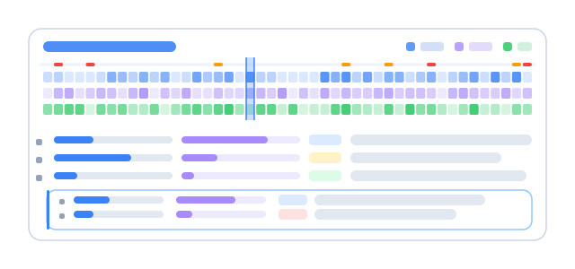

# Trace Lab

A DeepSeek Harness bundle that turns a session's trace log into a readable product view instead of raw JSON: **session → run (one instruction) → step (one agent loop) → operations**, with a heat matrix for spotting the expensive run and a list for reading what actually happened.



## What you get

- **Heat matrix, one column per run.** Three metric rows (time, tokens, steps) shaded by rank inside the session, plus a marker lane for errors and slow operations. Point at a column to read that run and highlight its row; click to park it at the top of the list and expand it.
- **Run rows with their own bars.** Every run shows its time and token bar, a role tag, and the prompt; steps below it show what the step did as a tag (`READ`, `EDIT`, `RUN`, `REPLY`, …) plus multiple action chips with counts.
- **Step detail.** Expand a step for the model reply with in/out tokens, each tool call's arguments and result, the injected context, and a collapsed **RAW** view of the original events.
- **Official timing.** Step time is model time plus tool time; waiting for you is shown separately (`⏸`) and never counted. Run time is the sum of its steps.
- **Live, read-only.** No model requests, no writes to the session. It reads the session log locally and polls the log offset every 2 seconds while the panel is visible, so a running session keeps updating.

## Install

Trace Lab is distributed through a **DSH plugin index** (Discover tab of the Plugin Manager). Add the index URL, search for "Trace Lab", and install. Or, for local development, link the package into a profile:

```powershell
# in a DSH profile directory
pnpm add "link:<path-to-this-package>"
```

then add the bundle to `dsh.profile.bundles` in that profile's `package.json`.

## Limits

- Current session only: no cross-session comparison, lineage view, search, or export.
- English UI; the view ring label is localized.
- Large sessions: the run list is served in pages of 80 steps; a very long run fades in instead of animating height.

## License

[MIT](../LICENSE)
